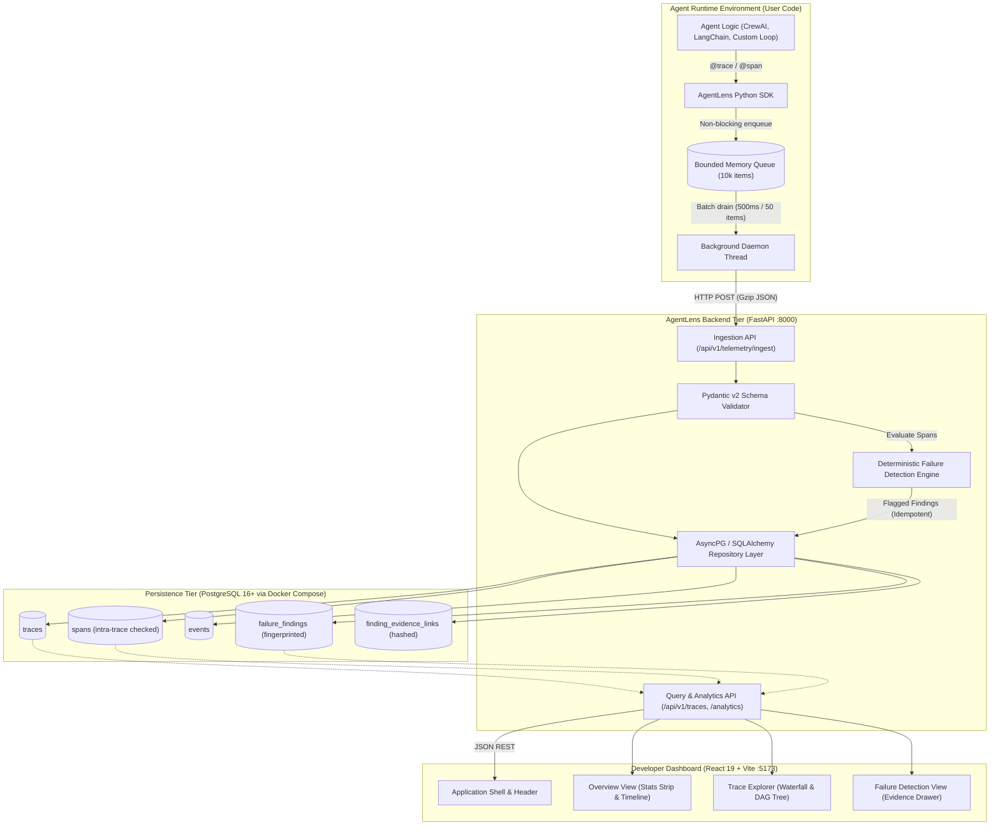
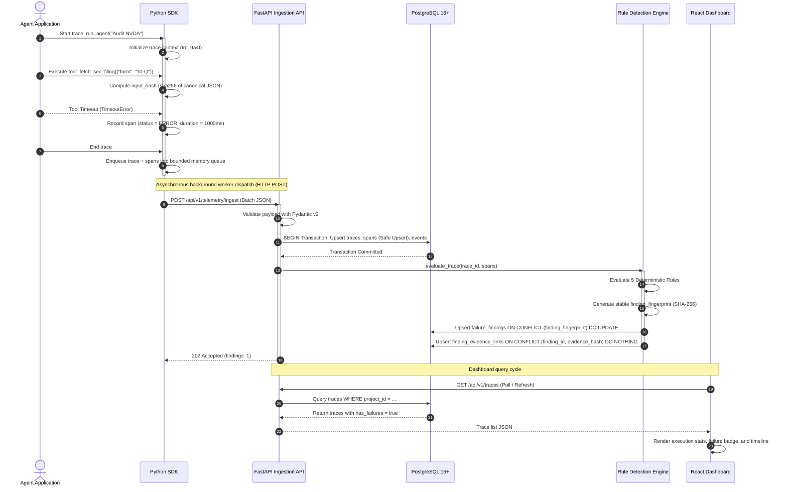

# AgentLens — System Architecture Specification

**Stage 2: Technical Architecture & System Design**
*Document Version: 2.2.0*
*Status: Architecture Specification (Incorporating Span Upsert Safety, Compound FK Semantics & Evidence Idempotency)*

---

## 1. High-Level System Architecture

AgentLens is a developer-focused observability and failure debugging platform designed to instrument autonomous agent workflows, capture execution telemetry, deterministically identify execution defects, and provide evidence-backed root-cause diagnosis.

The architecture comprises four decoupled operational tiers:

```
+---------------------------------------------------------------------------------+
|                    1. Agent Runtime Environment (Python SDK)                    |
|  - Decorators (@agentlens.trace, @agentlens.span) & Context Managers            |
|  - Local sanitization, payload truncation (64KB), canonical input hashing       |
|  - Bounded queue (10,000 items) + background daemon thread batch dispatcher     |
|  - Graceful shutdown (atexit/signals), circuit breaker on backend downtime      |
|  - HTTP POST batching exclusively for MVP (WebSocket deferred to Phase 2)       |
+---------------------------------------------------------------------------------+
                                      │ HTTP POST /api/v1/telemetry/ingest (Gzip JSON)
                                      ▼
+---------------------------------------------------------------------------------+
|                    2. Backend Service Tier (FastAPI :8000)                      |
|  - Ingestion Router with idempotency & deduplication handling                   |
|  - Pydantic v2 schema validation & AsyncPG repository transactions              |
|  - Deterministic Failure Detection Rules Engine (5 Core Rules)                  |
|  - Query & Aggregation API (/api/v1/traces, /analytics, /health)                |
|  - Configurable AsyncPG pool (dev defaults: pool_size=5, max_overflow=15)      |
+---------------------------------------------------------------------------------+
                                      │ AsyncPG Transactions / Indexed Queries
                                      ▼
+---------------------------------------------------------------------------------+
|                    3. Persistence Tier (PostgreSQL 16+)                         |
|  - Docker Compose service: postgres:16-alpine only                              |
|  - 6 Core Business Entities: projects, environments, traces, spans,             |
|    events, failure_findings                                                     |
|  - Auxiliary Association Table: finding_evidence_links                          |
|  - Intra-trace span isolation (ON DELETE SET NULL (parent_span_id))              |
|  - Project-Environment referential integrity (fk_traces_env_project)            |
+---------------------------------------------------------------------------------+
                                      │ JSON REST Polling / Status Checks
                                      ▼
+---------------------------------------------------------------------------------+
|                    4. Developer Dashboard Tier (React 19)                       |
|  - Obsidian CAD-grid interface, honest empty states, sample trace preview       |
|  - Trace Explorer: Execution waterfall & interactive DAG tree (@xyflow/react)   |
|  - Failure Diagnostics: Evidence drawer with parameter diffs & failure proof    |
+---------------------------------------------------------------------------------+
```

---

## 2. System Architecture & Ingestion Flow Diagrams

### 2.1 Overall System Architecture Diagram



---

### 2.2 Telemetry Ingestion Sequence Diagram



---

## 3. Telemetry Ingestion & Data Flow Lifecycle

### Step 1: SDK Interception & Context Propagation
1. **Trace Initialization**: A new trace context is created with a globally unique `trace_id` (e.g. `trc_9a4f7e21`), associating the active `project_id` and `environment`.
2. **Context Propagation**: Python's `contextvars.ContextVar` tracks the active trace and parent span ID across asynchronous coroutines, threads, and sub-agent handoffs without requiring manual parameter passing.
3. **Payload Sanitization & Canonical Input Hashing**:
   - The SDK redacts sensitive keys matching `(?i)(api[_-]?key|auth|bearer|secret|password|token|private)` to `"[REDACTED]"`.
   - For `TOOL_CALL` spans, the SDK serializes input arguments into canonical JSON (sorted keys, no extraneous spaces) and computes a SHA-256 `input_hash`. This enables $O(1)$ repetition matching on the backend.
   - Text inputs and outputs exceeding 64 KB are truncated, setting `{"_truncated": true, "preview": "...first 1KB..."}` to prevent memory and network bloat.
4. **Span Completion**: As each span exits, end time, duration, status (`OK` or `ERROR`), error details, and model token counts (if reported by the provider) are recorded.

### Step 2: SDK Queueing & Dispatch
1. Completed spans enter a thread-safe bounded memory queue (`maxsize=10000`).
2. A background worker daemon thread drains the queue in batches (every 500ms or 50 spans), issuing an HTTP `POST /api/v1/telemetry/ingest` call with Gzip compression.
3. **MVP Protocol**: Ingestion uses HTTP POST batching exclusively. WebSocket streaming is deferred to Phase 2.

### Step 3: Backend Ingestion & Atomic Persistence
1. FastAPI validates incoming payloads with Pydantic v2 models.
2. Ingestion executes inside an atomic database transaction:
   - Traces are upserted: `INSERT ... ON CONFLICT (id) DO UPDATE`.
   - Spans are upserted using **Safe Upsert SQL** (Section 7.1) protecting terminal states and non-null values.
   - Events are inserted: `INSERT ... ON CONFLICT (id) DO NOTHING`.
3. If an individual batch fails validation (HTTP 422), it is rejected with a RFC 7807 problem detail payload without poisoning the worker queue.

### Step 4: Deterministic Failure Detection Pipeline
1. Post-persistence, the backend runs the **Deterministic Rule Engine** against newly ingested spans.
2. The engine computes a deterministic `finding_fingerprint` for each violation.
3. Findings are upserted into `failure_findings`: if a finding already exists (e.g. A tool repetition count increases from 3 to 4), the existing record is updated with the new iteration count and evidence links rather than creating duplicate findings.
4. Evidence links are inserted into `finding_evidence_links` with an `evidence_hash` unique constraint, safely ignoring duplicates.
5. The trace's `has_failures` flag is updated to `true`.

### Step 5: Dashboard Presentation
1. The React 19 frontend queries `/api/v1/traces` and `/api/v1/analytics/overview`.
2. Empty states are strictly respected when total executions are 0.
3. When traces exist, clicking a trace retrieves the full nested tree from `/api/v1/traces/{trace_id}` to render the execution waterfall, the `@xyflow/react` DAG graph, and the evidence drawer.

---

## 4. The Five Deterministic Failure Detection Rules

AgentLens relies exclusively on deterministic, mathematically verifiable rules rather than subjective LLM evaluation:

```
+-----------------------------------------------------------------------------------+
|                        Deterministic Failure Rules                                |
+-----------------------------------------------------------------------------------+
| 01. FAILED_SPAN         | span.status == 'ERROR' or error_message != null         |
| 02. REPEATED_TOOL_CALL  | Identical tool & args >= 3 times without retry context   |
| 03. EXCESSIVE_RETRIES   | attributes.retry_count > 3 (canonical single source)    |
| 04. SLOW_SPAN           | duration_ms > configured SLA threshold for span_type    |
| 05. EMPTY_TOOL_RESULT   | status == 'OK' and output is empty on non-whitelisted   |
+-----------------------------------------------------------------------------------+
```

---

### Rule 1: Failed Span
- **Rule Identifier**: `FAILED_SPAN`
- **Severity**: `CRITICAL` (for root agent step) / `HIGH` (for child tools/LLMs)
- **Problem Defined**: A span terminates with an unhandled exception or status `ERROR`.
- **Detection Algorithm**:
  ```python
  if span.status == "ERROR" or span.error_message is not None:
      flag_finding(
          rule_type="FAILED_SPAN",
          severity="CRITICAL" if span.parent_span_id is None else "HIGH",
          summary=f"Span '{span.name}' failed with {span.error_type or 'Error'}: {span.error_message}",
          evidence_summary=f"Unhandled exception in span {span.id} at {span.start_time}",
          evidence_data={
              "error_message": span.error_message,
              "error_type": span.error_type,
              "error_stack": span.error_stack,
              "duration_ms": span.duration_ms
          }
      )
  ```
- **Stored Data Required**: `status`, `error_message`, `error_type`, `error_stack`, `duration_ms`.

---

### Rule 2: Repeated Tool Call (Distinguishing Loops from Retries and Polling)
- **Rule Identifier**: `REPEATED_TOOL_CALL`
- **Severity**: `HIGH`
- **Problem Defined**: An agent enters a reasoning lock-in, repeatedly calling an identical tool with identical parameters.
- **Critical Distinctions**:
  1. **Legitimate Retries vs. Suspicious Repetition**: If a tool call fails with an error and is immediately re-executed, that is an *operation retry* (evaluated under Rule 3: `EXCESSIVE_RETRIES`). It is **NOT** classified as a `REPEATED_TOOL_CALL`. `REPEATED_TOOL_CALL` requires that the prior call completed or that the agent received a result and still repeated the call blindly.
  2. **Legitimate Polling / Pagination**: Certain tools inherently execute repeatedly with similar parameters (e.g. `check_task_status`, `poll_job`). Tools can specify `allow_polling: true` in `attributes` or project settings. Furthermore, if arguments change (such as `page=1 -> page=2` or `offset=0 -> offset=50`), the `input_hash` is different, so it is **never** flagged.
- **Detection Algorithm**:
  - Filter spans within the trace where `span_type == 'TOOL_CALL'`.
  - Sort by `start_time ASC`.
  - Group consecutive invocations matching identical `name` and identical `input_hash`.
  ```python
  # Require minimum 3 consecutive identical calls (>= 2 repeats)
  if repeat_count >= 3 and not tool_is_whitelisted_for_polling(span.name):
      # Verify this is not a legitimate error retry loop
      if not all(s.attributes.get("retry_count", 0) > 0 for s in matching_spans):
          flag_finding(
              rule_type="REPEATED_TOOL_CALL",
              severity="HIGH",
              iteration_count=repeat_count,
              summary=f"Tool '{span.name}' called {repeat_count} times consecutively with identical parameters",
              evidence_summary=f"Identical input_hash ({span.input_hash[:12]}...) across {repeat_count} spans within {window_ms}ms window",
              evidence_data={
                  "tool_name": span.name,
                  "input_hash": span.input_hash,
                  "input_payload": span.input_payload,
                  "contributing_spans": [{"id": s.id, "start_time": s.start_time, "duration_ms": s.duration_ms} for s in matching_spans]
              }
          )
  ```
- **Stored Data Required**: `name`, `input_payload`, `input_hash`, ordered execution timestamps, `attributes.allow_polling`.

---

### Rule 3: Retry Counting & Recovery Classification
- **Rule Identifier**: `EXCESSIVE_RETRIES`
- **Severity**: `HIGH` (for unrecovered retries ending in `ERROR`) / `WARNING` (for recovered retries ending in `OK`)
- **Canonical Single Source of Truth**:
  - `span.attributes['retry_count']` is defined as the **sole authoritative integer** for total retries.
  - Timestamped events with `name == 'retry_attempt'` provide the chronological audit log.
  - The engine inspects `attributes['retry_count']`; if absent, it falls back to `count(events where name == 'retry_attempt')`. The engine **never sums both**, eliminating double-counting.
- **Recovered vs. Unrecovered Retries**:
  - **Recovered Retry**: The operation retried $>3$ times but ultimately completed with `status == 'OK'`. Flagged as `WARNING`: *"Operation 'X' recovered after 4 retries (latency impact: 2,400ms)"*.
  - **Unrecovered Retry**: The operation retried $>3$ times and terminated with `status == 'ERROR'`. Flagged as `HIGH`: *"Operation 'X' failed after 4 exhausted retries"*.
- **Detection Algorithm**:
  ```python
  canonical_retry_count = span.attributes.get("retry_count")
  if canonical_retry_count is None:
      canonical_retry_count = len([e for e in span.events if e.name == "retry_attempt"])

  if canonical_retry_count > 3:
      is_recovered = (span.status == "OK")
      flag_finding(
          rule_type="EXCESSIVE_RETRIES",
          severity="WARNING" if is_recovered else "HIGH",
          summary=f"Operation '{span.name}' {'recovered after' if is_recovered else 'failed after'} {canonical_retry_count} retries (threshold: 3)",
          evidence_summary=f"Span {span.id} executed {canonical_retry_count} retries. Final outcome: {span.status}",
          evidence_data={
              "retry_count": canonical_retry_count,
              "final_status": span.status,
              "is_recovered": is_recovered,
              "duration_ms": span.duration_ms
          }
      )
  ```
- **Stored Data Required**: `attributes.retry_count`, `events.retry_attempt`, `status`, `duration_ms`.

---

### Rule 4: Slow Span & Configurable SLA Thresholds
- **Rule Identifier**: `SLOW_SPAN`
- **Severity**: `WARNING` (1x - 2x SLA limit) / `HIGH` (> 2x SLA limit)
- **Problem Defined**: A span exceeds its defined latency budget, identifying bottlenecks in vector search, external tools, or LLM generation.
- **Configurable SLA Limits**:
  SLA thresholds are **not hardcoded**. They are resolved via:
  1. Span-level attribute `span.attributes['sla_threshold_ms']` (highest precedence).
  2. Project settings `projects.settings['sla_thresholds']`.
  3. Environment variables: `AGENTLENS_SLA_LLM_MS`, `AGENTLENS_SLA_TOOL_MS`, `AGENTLENS_SLA_RETRIEVAL_MS`, `AGENTLENS_SLA_AGENT_STEP_MS`.
  4. System Initial Development Defaults:
     - `LLM_CALL`: 10,000 ms
     - `TOOL_CALL`: 5,000 ms
     - `RETRIEVAL`: 2,000 ms
     - `AGENT_STEP`: 15,000 ms
- **Detection Algorithm**:
  ```python
  limit_ms = resolve_sla_threshold(span.span_type, project_settings, span.attributes)
  if span.duration_ms and span.duration_ms > limit_ms:
      severity = "HIGH" if span.duration_ms > (limit_ms * 2) else "WARNING"
      flag_finding(
          rule_type="SLOW_SPAN",
          severity=severity,
          summary=f"Span '{span.name}' took {span.duration_ms}ms (exceeded {span.span_type} threshold of {limit_ms}ms)",
          evidence_summary=f"Execution latency {span.duration_ms}ms is {span.duration_ms - limit_ms}ms over the {limit_ms}ms budget",
          evidence_data={
              "duration_ms": span.duration_ms,
              "sla_limit_ms": limit_ms,
              "delta_ms": span.duration_ms - limit_ms,
              "span_type": span.span_type
          }
      )
  ```
- **Stored Data Required**: `span_type`, `start_time`, `end_time`, `duration_ms`, SLA configuration.

---

### Rule 5: Empty Tool Result & Configurable Whitelists
- **Rule Identifier**: `EMPTY_TOOL_RESULT`
- **Severity**: `WARNING`
- **Problem Defined**: A tool completes with status `OK` (exit 0) but returns empty data, starving the downstream agent of context and precipitating hallucinations.
- **Accounting for Legitimate Empty Tools**:
  - Certain tools naturally return empty or null on success (e.g. `delete_record()`, `send_email()`, `write_file()`, `clear_cache()`).
  - **Exclusion Mechanism**:
    1. Span metadata: `span.attributes['allow_empty'] == true`.
    2. Project configuration: `projects.settings['allowed_empty_tools'] = ["delete_*", "send_*", "write_*", "clear_*", "notify_*"]`.
    3. If the tool matches an exclusion pattern, the rule is **not triggered**.
- **Detection Algorithm**:
  ```python
  if span.span_type == "TOOL_CALL" and span.status == "OK":
      out = span.output_payload
      is_empty = (
          out is None or
          out == "" or
          out == {} or
          out == [] or
          (isinstance(out, str) and out.strip() == "")
      )
      if is_empty and not tool_allows_empty_result(span.name, project_settings, span.attributes):
          flag_finding(
              rule_type="EMPTY_TOOL_RESULT",
              severity="WARNING",
              summary=f"Tool '{span.name}' returned an empty result payload upon status OK",
              evidence_summary=f"Tool '{span.name}' executed in {span.duration_ms}ms and returned empty output ({type(out).__name__}), risking LLM context starvation",
              evidence_data={
                  "tool_name": span.name,
                  "input_payload": span.input_payload,
                  "output_payload": span.output_payload,
                  "duration_ms": span.duration_ms
              }
          )
  ```
- **Stored Data Required**: `span_type`, `status`, `name`, `input_payload`, `output_payload`, tool exclusion configuration.

---

## 5. Finding & Evidence Idempotency

To guarantee reproducibility and prevent finding duplication when telemetry is evaluated repeatedly or arrives via incremental streams:

### 5.1 Deterministic Fingerprint Formula
$$\text{finding\_fingerprint} = \text{SHA256}(\text{rule\_type} + \text{":"} + \text{trace\_id} + \text{":"} + \text{COALESCE(span\_id, '')} + \text{":"} + \text{rule\_version})$$

### 5.2 Deterministic Evidence Link Hash
$$\text{evidence\_hash} = \text{SHA256}(\text{finding\_id} + \text{":"} + \text{COALESCE(span\_id, '')} + \text{":"} + \text{COALESCE(event\_id, '')} + \text{":"} + \text{role})$$

### 5.3 Idempotent Upsert Queries
When rule evaluation runs:
```sql
-- 1. Upsert Finding
INSERT INTO failure_findings (
    id, finding_fingerprint, rule_version, trace_id, span_id, rule_type,
    severity, iteration_count, summary, evidence_summary, evidence_data
) VALUES (...)
ON CONFLICT (finding_fingerprint) DO UPDATE SET
    iteration_count = EXCLUDED.iteration_count,
    severity = EXCLUDED.severity,
    summary = EXCLUDED.summary,
    evidence_summary = EXCLUDED.evidence_summary,
    evidence_data = EXCLUDED.evidence_data,
    last_updated_at = CLOCK_TIMESTAMP();

-- 2. Upsert Evidence Links
INSERT INTO finding_evidence_links (
    finding_id, span_id, event_id, role, evidence_hash
) VALUES (...)
ON CONFLICT (finding_id, evidence_hash) DO NOTHING;
```

---

## 6. SDK Reliability, Backoff & Delivery Guarantees

The AgentLens Python SDK (`agentlens`) is engineered with zero-impact principles: **an observability library must never crash, hang, or noticeably slow down the host AI agent**.

### 6.1 Graceful Shutdown & Queue Flushing
- **Process Exit Hooks**: The SDK registers cleanup handlers using Python's `atexit.register()` and signal listeners for `SIGINT` and `SIGTERM`.
- **Flush Protocol**: Upon process termination, the daemon thread attempts to flush pending queue buffers with a strict 5.0-second timeout:
  ```python
  def shutdown(timeout: float = 5.0):
      sdk_queue.join() # Drain pending items up to timeout
  ```
- If the backend is unreachable during shutdown, the worker logs a local warning and exits cleanly without hanging the host process.

### 6.2 Bounded Queue Overflow Behavior
- The SDK utilizes a thread-safe in-memory buffer (`queue.Queue(maxsize=10000)`).
- **Overflow Policy**: When the queue reaches capacity (e.g. Massive agent concurrency or sustained network partition), the SDK adopts a **Drop Oldest** policy:
  - The oldest batch is discarded.
  - A local atomic counter `telemetry_dropped_overflow` increments.
  - An event marker is injected into the next successful batch notifying the backend of lost telemetry.
  - **The host application's main thread is never blocked.**

### 6.3 Retry, Exponential Backoff & Circuit Breaker
- Ingestion dispatch utilizes jittered exponential backoff:
  - Attempt 1: Immediate.
  - Attempt 2: 500ms + jitter.
  - Attempt 3: 1,500ms + jitter.
  - Attempt 4: 4,000ms + jitter.
  - Max attempts: 4 before returning batch to head of queue or dropping.
- **Circuit Breaker on Backend Downtime**:
  - If the FastAPI service is unreachable for 3 consecutive dispatch attempts, the SDK enters **Quiet Mode** for 60 seconds.
  - Dispatches are paused, preventing network thread thrashing.
  - A single concise warning is logged locally once per minute.

### 6.4 Invalid Batch Handling (HTTP 422)
- If the backend returns HTTP 422 (Unprocessable Entity) or 400 (Bad Request), the SDK treats the batch as fatally malformed.
- The malformed batch is **not retried** (preventing poison-pill loops). It is discarded from the queue and logged to `stderr`.

### 6.5 Delivery Guarantees & Limitations
- **Guarantee**: **At-Least-Once Delivery** under normal process shutdown and recoverable network partitions, paired with server-side deduplication.
- **Limitation**: Telemetry buffered in memory during an uncatchable `SIGKILL` (`kill -9`) or catastrophic power failure cannot be preserved without expensive local disk writes.

---

## 7. Ingestion Reliability & Safe Upsert Execution

### 7.1 Span Upsert Safety & Out-of-Order Packet Handling
When delayed or duplicate packets arrive at `POST /api/v1/telemetry/ingest`, the database query must ensure that completed telemetry is not corrupted by stale or partial packets:
- **Immutable Fields**: `id`, `trace_id`, `name`, `span_type`, `start_time`, `input_payload`, `input_hash`, `parent_span_id` are never mutated once created.
- **Terminal Status Protection**: Once a span reaches `OK` or `ERROR`, an incoming `RUNNING` status is strictly ignored.
- **Non-Destructive Coalescing**: End timestamps, durations, and output payloads are only updated if the incoming payload contains non-null values.
- **Attribute Merging**: Existing attributes are preserved while new attributes are appended (`spans.attributes || EXCLUDED.attributes`).

### 7.2 Database Connection Pool Configuration
To balance concurrency with database resource safety in local development and production environments:
- **Initial Development Defaults**:
  - `pool_size = 5` (Baseline connections maintained in pool)
  - `max_overflow = 15` (Max additional temporary connections under burst load)
  - **Total Maximum Connections**: `20` per FastAPI process.
- **Configurable Environment Variables**:
  - `AGENTLENS_DB_POOL_SIZE`: Overrides baseline pool size.
  - `AGENTLENS_DB_MAX_OVERFLOW`: Overrides overflow burst allowance.
  - `AGENTLENS_DB_POOL_TIMEOUT`: Default 30s connection acquisition timeout.
  - `AGENTLENS_DB_POOL_RECYCLE`: Default 1800s (30m) connection recycling.
- *Documentation Note*: These settings represent initial development and testing defaults, not universal production guidelines. Production deployments must scale pool size according to worker process counts and PostgreSQL server limits (`max_connections`).

---

## 8. Implementation Status Matrix

| Module | Implemented in Repository | Stage 2 Design Status | Implementation Target |
| :--- | :---: | :---: | :--- |
| **FastAPI Skeleton & CORS** | Yes (`backend/app/main.py`) | Configured for `5173`, `4173-4175` | Operational |
| **Health Check Endpoint** | Yes (`GET /health`) | PostgreSQL ping extension defined | Stage 2 |
| **Docker Compose Config** | No (Planned) | `postgres:16-alpine` only | Stage 2 Implementation |
| **PostgreSQL Persistence** | No (Planned) | Complete DDL in `DATABASE_DESIGN.md` | Stage 2 Implementation |
| **SQLAlchemy 2.0 Async / asyncpg** | No (Planned) | Pool defaults: pool_size=5, max_overflow=15 | Stage 2 Implementation |
| **Alembic Migrations** | No (Planned) | Initial migration baseline specified | Stage 2 Implementation |
| **Telemetry Ingestion API** | No (Planned) | HTTP POST batching in `API_DESIGN.md` | Stage 3 Implementation |
| **Deterministic Rule Engine** | No (Planned) | 5 Rules detailed in Section 4 | Stage 3 Implementation |
| **Finding Fingerprinting** | No (Planned) | Idempotent upsert logic specified | Stage 3 Implementation |
| **Python Instrumentation SDK** | No (Planned) | Threaded bounded queue & decorators | Stage 4 Implementation |
| **Trace Explorer & Waterfall UI** | Foundation active | Dynamic REST wiring planned | Stage 5 Integration |
| **Failure Diagnosis Drawer** | Foundation active | Evidence link query wiring planned | Stage 6 Integration |
