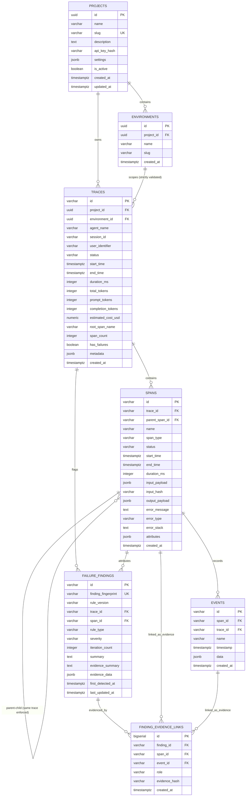

# AgentLens — Database Design & Schema Specification

**Stage 2: Technical Architecture & Database Design**
*Document Version: 2.2.0*
*Status: Architecture Specification (Incorporating Span Upsert Safety, Compound FK Semantics & Evidence Idempotency)*

---

## 1. Overview & Core Architectural Principles

AgentLens requires a relational, ACID-compliant persistence store optimized for high-throughput telemetry ingestion, deterministic failure deduplication, and low-latency hierarchical trace traversal. PostgreSQL 16+ is selected as the primary database engine, combined with SQLAlchemy 2.0 Async, `asyncpg`, and Alembic.

### 1.1 Structural Entity Classification

AgentLens strictly distinguishes between the **six core business domain entities** and **auxiliary association structures**:

```
+---------------------------------------------------------------------------------+
|                         SIX CORE BUSINESS ENTITIES                              |
+---------------------------------------------------------------------------------+
| 1. Project          | Root tenant isolating agents, API keys, and team scopes   |
| 2. Environment      | Isolated runtime tier (development, staging, production)  |
| 3. Trace            | Discrete end-to-end agent workflow execution session      |
| 4. Span             | Discrete hierarchical unit of work in a trace             |
| 5. Event            | Timestamped instant marker/milestone within a span        |
| 6. Failure Finding  | Evidence-backed defect identified by deterministic rules  |
+---------------------------------------------------------------------------------+
|                       AUXILIARY ASSOCIATION TABLE                               |
+---------------------------------------------------------------------------------+
| * finding_evidence_links | Junction linking a finding to contributing spans/events |
+---------------------------------------------------------------------------------+
```

### 1.2 Referential Consistency & Boundary Enforcements

1. **Intra-Trace Span Hierarchy Guarantee**:
   - Parent-child span relationships **cannot cross trace boundaries**. A child span in Trace A must never reference a parent span in Trace B.
   - *PostgreSQL 16 Syntax*: Enforced via a compound unique constraint on `spans(id, trace_id)` and a compound self-referencing foreign key specifying column-specific nullification:
     ```sql
     CONSTRAINT uq_spans_id_trace_id UNIQUE (id, trace_id),
     CONSTRAINT fk_spans_parent_same_trace FOREIGN KEY (parent_span_id, trace_id)
         REFERENCES spans(id, trace_id)
         ON DELETE SET NULL (parent_span_id)
     ```
   - **Behavior Verification**: PostgreSQL 15+ supports the SQL:2008 standard `ON DELETE SET NULL (<column_list>)`. When a parent span is deleted, PostgreSQL **only nullifies `parent_span_id`**, leaving the non-nullable `trace_id` completely intact. When the parent trace is deleted, the cascade on `FOREIGN KEY (trace_id) REFERENCES traces(id) ON DELETE CASCADE` drops all associated spans cleanly.
2. **Project-Environment-Trace Referential Consistency**:
   - A trace must not reference an environment belonging to a different project.
   - *PostgreSQL Enforcement*: Enforced via a compound unique constraint on `environments(id, project_id)` and a compound foreign key on `traces(environment_id, project_id) REFERENCES environments(id, project_id) ON DELETE CASCADE`.
3. **Finding & Evidence Idempotency**:
   - Each failure finding carries a deterministic `finding_fingerprint` (SHA-256).
   - Each evidence association carries a deterministic `evidence_hash` (SHA-256). Evaluating rules multiple times updates existing findings and attaches missing evidence safely without duplicating rows.

---

## 2. Entity-Relationship Diagram (ERD)



---

## 3. Detailed Core Business Entities

### 3.1 Entity 1: `projects`
Root tenant boundary isolating telemetry, team access, API credentials, and project-specific rule configurations.

| Column | Type | Constraints | Nullable | Default | Description |
| :--- | :--- | :--- | :--- | :--- | :--- |
| `id` | `UUID` | `PRIMARY KEY` | No | `gen_random_uuid()` | Unique project identifier |
| `name` | `VARCHAR(128)` | | No | | Project display name |
| `slug` | `VARCHAR(128)` | `UNIQUE` | No | | URL-safe slug (e.g. `customer-service-agent`) |
| `description` | `TEXT` | | Yes | `NULL` | Optional project documentation |
| `api_key_hash` | `VARCHAR(64)` | | Yes | `NULL` | SHA-256 hash of ingestion API secret |
| `settings` | `JSONB` | | No | `'{}'::jsonb` | Project configuration (custom SLA thresholds, tool whitelists) |
| `is_active` | `BOOLEAN` | | No | `TRUE` | Ingestion status switch |
| `created_at` | `TIMESTAMPTZ` | | No | `CLOCK_TIMESTAMP()` | Record creation timestamp |
| `updated_at` | `TIMESTAMPTZ` | | No | `CLOCK_TIMESTAMP()` | Metadata update timestamp |

**Indexes & Constraints**:
- `idx_projects_slug`: Unique B-tree on `slug`.
- `idx_projects_api_key_hash`: B-tree on `api_key_hash` WHERE `api_key_hash IS NOT NULL`.

---

### 3.2 Entity 2: `environments`
Represents isolated runtime deployment tiers within a project.

| Column | Type | Constraints | Nullable | Default | Description |
| :--- | :--- | :--- | :--- | :--- | :--- |
| `id` | `UUID` | `PRIMARY KEY` | No | `gen_random_uuid()` | Unique environment identifier |
| `project_id` | `UUID` | `REFERENCES projects(id) ON DELETE CASCADE` | No | | Parent project |
| `name` | `VARCHAR(64)` | | No | | Display name (`Production`, `Staging`, `Development`) |
| `slug` | `VARCHAR(32)` | | No | | Canonical identifier (`production`, `staging`, `development`) |
| `created_at` | `TIMESTAMPTZ` | | No | `CLOCK_TIMESTAMP()` | Creation timestamp |

**Indexes & Constraints**:
- `uq_project_env_slug`: Unique constraint on `(project_id, slug)`.
- `uq_environments_id_project_id`: Unique compound constraint on `(id, project_id)`. **Required for foreign key referential integrity from `traces`.**

---

### 3.3 Entity 3: `traces`
Represents a single end-to-end execution of an AI agent.

| Column | Type | Constraints | Nullable | Default | Description |
| :--- | :--- | :--- | :--- | :--- | :--- |
| `id` | `VARCHAR(64)` | `PRIMARY KEY` | No | | Unique trace identifier (`trc_...`) |
| `project_id` | `UUID` | `REFERENCES projects(id) ON DELETE CASCADE` | No | | Parent project |
| `environment_id` | `UUID` | | No | | Runtime environment |
| `agent_name` | `VARCHAR(128)` | | No | | Name of agent class/workflow |
| `session_id` | `VARCHAR(128)` | | Yes | `NULL` | Conversation or multi-turn session ID |
| `user_identifier` | `VARCHAR(128)` | | Yes | `NULL` | Optional pseudonymized end-user ID |
| `status` | `VARCHAR(32)` | | No | `'RUNNING'` | `RUNNING`, `SUCCESS`, `ERROR`, `PARTIAL` |
| `start_time` | `TIMESTAMPTZ` | | No | | Execution start timestamp |
| `end_time` | `TIMESTAMPTZ` | | Yes | `NULL` | Execution completion timestamp |
| `duration_ms` | `INTEGER` | | Yes | `NULL` | Total duration in ms |
| `total_tokens` | `INTEGER` | | Yes | `NULL` | Total tokens (prompt + completion) |
| `prompt_tokens` | `INTEGER` | | Yes | `NULL` | Aggregated input prompt tokens |
| `completion_tokens`| `INTEGER` | | Yes | `NULL` | Aggregated completion tokens |
| `estimated_cost_usd`| `NUMERIC(10, 6)` | | Yes | `NULL` | Estimated financial model cost in USD |
| `root_span_name` | `VARCHAR(255)` | | Yes | `NULL` | Name of the root span for fast display |
| `span_count` | `INTEGER` | | No | `0` | Number of recorded spans |
| `has_failures` | `BOOLEAN` | | No | `FALSE` | Boolean flag indicating $\ge 1$ failure finding |
| `metadata` | `JSONB` | | No | `'{}'::jsonb` | Framework version, git commit, host environment |
| `created_at` | `TIMESTAMPTZ` | | No | `CLOCK_TIMESTAMP()` | Ingestion timestamp |

**Indexes & Constraints**:
- `fk_traces_env_project`: **Compound Foreign Key**: `FOREIGN KEY (environment_id, project_id) REFERENCES environments(id, project_id) ON DELETE CASCADE`. Prevents a trace from pointing to an environment in another project.
- `idx_traces_proj_env_start`: Compound B-tree on `(project_id, environment_id, start_time DESC)`. Primary query index.
- `idx_traces_status`: B-tree on `status`.
- `idx_traces_has_failures`: Partial B-tree on `has_failures` WHERE `has_failures = TRUE`.
- `idx_traces_session_id`: B-tree on `session_id` WHERE `session_id IS NOT NULL`.
- `idx_traces_metadata_gin`: GIN index on `metadata`.

---

### 3.4 Entity 4: `spans`
Represents a discrete hierarchical unit of work (LLM call, tool call, reasoning step, vector retrieval).

| Column | Type | Constraints | Nullable | Default | Description |
| :--- | :--- | :--- | :--- | :--- | :--- |
| `id` | `VARCHAR(64)` | `PRIMARY KEY` | No | | Span ID (`spn_...`) |
| `trace_id` | `VARCHAR(64)` | `REFERENCES traces(id) ON DELETE CASCADE` | No | | Parent trace |
| `parent_span_id` | `VARCHAR(64)` | | Yes | `NULL` | Parent span ID within the same trace. `NULL` denotes root span |
| `name` | `VARCHAR(255)` | | No | | Span name (e.g. `search_database`) |
| `span_type` | `VARCHAR(32)` | | No | | `AGENT_STEP`, `LLM_CALL`, `TOOL_CALL`, `RETRIEVAL`, `ROUTING` |
| `status` | `VARCHAR(32)` | | No | `'RUNNING'` | `RUNNING`, `OK`, `ERROR` |
| `start_time` | `TIMESTAMPTZ` | | No | | Start timestamp |
| `end_time` | `TIMESTAMPTZ` | | Yes | `NULL` | Completion timestamp |
| `duration_ms` | `INTEGER` | | Yes | `NULL` | Elapsed duration in ms |
| `input_payload` | `JSONB` | | Yes | `NULL` | Sanitized input arguments (truncated if >64KB) |
| `input_hash` | `VARCHAR(64)` | | Yes | `NULL` | SHA-256 hash of canonical JSON input parameters |
| `output_payload` | `JSONB` | | Yes | `NULL` | Sanitized output response |
| `error_message` | `TEXT` | | Yes | `NULL` | Error string or exception message |
| `error_type` | `VARCHAR(128)` | | Yes | `NULL` | Exception class (e.g. `TimeoutError`, `RateLimitError`) |
| `error_stack` | `TEXT` | | Yes | `NULL` | Sanitized stack trace |
| `attributes` | `JSONB` | | No | `'{}'::jsonb` | Model, temperature, canonical retry count, custom metrics |
| `created_at` | `TIMESTAMPTZ` | | No | `CLOCK_TIMESTAMP()` | Ingestion timestamp |

**Indexes & Constraints**:
- `uq_spans_id_trace_id`: Compound Unique constraint on `(id, trace_id)`.
- `fk_spans_parent_same_trace`: **Compound Foreign Key with Column-Specific Nullification**:
  ```sql
  CONSTRAINT fk_spans_parent_same_trace FOREIGN KEY (parent_span_id, trace_id)
      REFERENCES spans(id, trace_id)
      ON DELETE SET NULL (parent_span_id)
  ```
  *Safety Guarantee*: Only `parent_span_id` is set to NULL on parent span deletion; `trace_id` remains strictly untouched.
- `idx_spans_trace_id_start`: Compound B-tree on `(trace_id, start_time ASC)` for waterfall ordering.
- `idx_spans_parent_span_id`: B-tree on `parent_span_id` for DAG tree generation.
- `idx_spans_span_type`: B-tree on `span_type`.
- `idx_spans_status_error`: Partial B-tree on `(trace_id, status)` WHERE `status = 'ERROR'`.
- `idx_spans_input_hash`: Partial B-tree on `(trace_id, input_hash)` WHERE `input_hash IS NOT NULL`.
- `idx_spans_attributes_gin`: GIN index on `attributes`.

---

### 3.5 Entity 5: `events`
Represents an instantaneous occurrence or log milestone within a span.

| Column | Type | Constraints | Nullable | Default | Description |
| :--- | :--- | :--- | :--- | :--- | :--- |
| `id` | `VARCHAR(64)` | `PRIMARY KEY` | No | | Unique event identifier (`evt_...`) |
| `span_id` | `VARCHAR(64)` | `REFERENCES spans(id) ON DELETE CASCADE` | No | | Associated span |
| `trace_id` | `VARCHAR(64)` | `REFERENCES traces(id) ON DELETE CASCADE` | No | | Denormalized trace identifier for rapid filtering |
| `name` | `VARCHAR(128)` | | No | | Event name (e.g. `retry_attempt`, `token_milestone`) |
| `timestamp` | `TIMESTAMPTZ` | | No | | Instant of event occurrence |
| `data` | `JSONB` | | No | `'{}'::jsonb` | Event attributes and diagnostic metadata |
| `created_at` | `TIMESTAMPTZ` | | No | `CLOCK_TIMESTAMP()` | Ingestion timestamp |

**Indexes**:
- `idx_events_span_timestamp`: Compound B-tree on `(span_id, timestamp ASC)`.
- `idx_events_trace_id`: B-tree on `trace_id`.
- `idx_events_name`: B-tree on `name`.

---

### 3.6 Entity 6: `failure_findings`
Represents an evidence-backed defect or suspicious pattern detected by the deterministic rules engine.

| Column | Type | Constraints | Nullable | Default | Description |
| :--- | :--- | :--- | :--- | :--- | :--- |
| `id` | `VARCHAR(64)` | `PRIMARY KEY` | No | | Finding identifier (`flr_...`) |
| `finding_fingerprint`| `VARCHAR(64)` | `UNIQUE` | No | | Deterministic SHA-256 fingerprint for idempotency |
| `rule_version` | `VARCHAR(16)` | | No | `'v1.0.0'` | Semantic rule engine version for reproducibility |
| `trace_id` | `VARCHAR(64)` | `REFERENCES traces(id) ON DELETE CASCADE` | No | | Parent trace |
| `span_id` | `VARCHAR(64)` | `REFERENCES spans(id) ON DELETE CASCADE` | No | | Primary affected span |
| `rule_type` | `VARCHAR(64)` | | No | | `FAILED_SPAN`, `REPEATED_TOOL_CALL`, `EXCESSIVE_RETRIES`, `SLOW_SPAN`, `EMPTY_TOOL_RESULT` |
| `severity` | `VARCHAR(32)` | | No | | `CRITICAL`, `HIGH`, `WARNING` |
| `iteration_count` | `INTEGER` | | No | `1` | Cumulative counter of detected iterations (e.g. loop size) |
| `summary` | `TEXT` | | No | | Developer diagnostic summary |
| `evidence_summary` | `TEXT` | | No | | Detailed explanation of supporting proof |
| `evidence_data` | `JSONB` | | No | | Structured proof payload (hashes, durations, delta stats) |
| `first_detected_at`| `TIMESTAMPTZ`| | No | `CLOCK_TIMESTAMP()` | Initial detection timestamp |
| `last_updated_at` | `TIMESTAMPTZ`| | No | `CLOCK_TIMESTAMP()` | Timestamp when additional evidence updated the finding |

**Fingerprint Formula**:
$$\text{finding\_fingerprint} = \text{SHA256}(\text{rule\_type} + \text{":"} + \text{trace\_id} + \text{":"} + \text{COALESCE(span\_id, '')} + \text{":"} + \text{rule\_version})$$

**Indexes**:
- `idx_findings_fingerprint`: Unique B-tree on `finding_fingerprint`.
- `idx_findings_trace_id`: B-tree on `trace_id`.
- `idx_findings_rule_type`: B-tree on `rule_type`.
- `idx_findings_severity`: B-tree on `severity`.
- `idx_findings_detected`: B-tree on `first_detected_at DESC`.

---

## 4. Auxiliary Association Table: `finding_evidence_links`

This table links a failure finding to multiple contributing spans and events, preserving evidence trails without duplicating finding entries.

| Column | Type | Constraints | Nullable | Default | Description |
| :--- | :--- | :--- | :--- | :--- | :--- |
| `id` | `BIGSERIAL` | `PRIMARY KEY` | No | | Auto-incrementing identifier |
| `finding_id` | `VARCHAR(64)` | `REFERENCES failure_findings(id) ON DELETE CASCADE` | No | | Parent finding |
| `span_id` | `VARCHAR(64)` | `REFERENCES spans(id) ON DELETE CASCADE` | Yes | `NULL` | Contributing span |
| `event_id` | `VARCHAR(64)` | `REFERENCES events(id) ON DELETE CASCADE` | Yes | `NULL` | Contributing event |
| `role` | `VARCHAR(64)` | | No | `'contributing'` | Evidence role: `trigger`, `predecessor`, `iteration`, `context` |
| `evidence_hash` | `VARCHAR(64)` | | No | | Deterministic SHA-256 hash preventing duplicate link rows |
| `created_at` | `TIMESTAMPTZ` | | No | `CLOCK_TIMESTAMP()` | Association timestamp |

**Evidence Hash Formula**:
$$\text{evidence\_hash} = \text{SHA256}(\text{finding\_id} + \text{":"} + \text{COALESCE(span\_id, '')} + \text{":"} + \text{COALESCE(event\_id, '')} + \text{":"} + \text{role})$$

**Constraints & Indexes**:
- `chk_evidence_target`: Check constraint `(span_id IS NOT NULL OR event_id IS NOT NULL)`.
- `uq_finding_evidence_hash`: **Unique constraint on `(finding_id, evidence_hash)`**. Ensures safe idempotency (`ON CONFLICT (finding_id, evidence_hash) DO NOTHING`).
- `idx_evidence_finding_id`: B-tree on `finding_id`.
- `idx_evidence_span_id`: Partial B-tree on `span_id` WHERE `span_id IS NOT NULL`.

---

## 5. Span Upsert Safety & Out-of-Order Packet Handling

When telemetry arrives in multiple batches (or when delayed network packets retransmit earlier span states), the database ingestion query must guarantee that **completed telemetry is never corrupted by stale or incomplete packets**:

### 5.1 Immutable vs. Mutable Fields

| Category | Columns | Ingestion Rule |
| :--- | :--- | :--- |
| **Immutable** | `id`, `trace_id`, `name`, `span_type`, `start_time`, `input_payload`, `input_hash`, `parent_span_id` | Set only on initial insert. **Never overwritten** during an upsert. |
| **Terminal Status Protected** | `status` | If existing row is `OK` or `ERROR`, incoming `RUNNING` status is **strictly ignored**. |
| **Non-Destructive Coalesced** | `end_time`, `duration_ms`, `output_payload`, `error_message`, `error_type`, `error_stack` | Updated only if incoming value is not null and existing value is null (or newer timestamp). |
| **Merged Semi-Structured** | `attributes` | JSONB concatenation (`spans.attributes || EXCLUDED.attributes`), preserving existing keys while appending new ones. |

### 5.2 Canonical Safe Upsert SQL Query

```sql
INSERT INTO spans (
    id, trace_id, parent_span_id, name, span_type, status,
    start_time, end_time, duration_ms, input_payload, input_hash,
    output_payload, error_message, error_type, error_stack, attributes
) VALUES (
    :id, :trace_id, :parent_span_id, :name, :span_type, :status,
    :start_time, :end_time, :duration_ms, :input_payload, :input_hash,
    :output_payload, :error_message, :error_type, :error_stack, :attributes
)
ON CONFLICT (id) DO UPDATE SET
    -- Prevent terminal status regression
    status = CASE
        WHEN spans.status IN ('OK', 'ERROR') THEN spans.status
        ELSE EXCLUDED.status
    END,
    -- Prevent wiping out end timestamps or durations
    end_time = COALESCE(EXCLUDED.end_time, spans.end_time),
    duration_ms = COALESCE(EXCLUDED.duration_ms, spans.duration_ms),
    -- Non-destructive payload update
    output_payload = COALESCE(EXCLUDED.output_payload, spans.output_payload),
    error_message = COALESCE(EXCLUDED.error_message, spans.error_message),
    error_type = COALESCE(EXCLUDED.error_type, spans.error_type),
    error_stack = COALESCE(EXCLUDED.error_stack, spans.error_stack),
    -- Merge attributes non-destructively
    attributes = spans.attributes || EXCLUDED.attributes;
```

---

## 6. PostgreSQL 16+ DDL Reference Script

```sql
-- PostgreSQL 16+ DDL Reference Specification for AgentLens Stage 2

CREATE EXTENSION IF NOT EXISTS "pgcrypto";

-- 1. Projects
CREATE TABLE projects (
    id UUID PRIMARY KEY DEFAULT gen_random_uuid(),
    name VARCHAR(128) NOT NULL,
    slug VARCHAR(128) UNIQUE NOT NULL,
    description TEXT,
    api_key_hash VARCHAR(64),
    settings JSONB NOT NULL DEFAULT '{}'::jsonb,
    is_active BOOLEAN NOT NULL DEFAULT TRUE,
    created_at TIMESTAMPTZ NOT NULL DEFAULT CLOCK_TIMESTAMP(),
    updated_at TIMESTAMPTZ NOT NULL DEFAULT CLOCK_TIMESTAMP()
);

CREATE INDEX idx_projects_slug ON projects(slug);
CREATE INDEX idx_projects_api_key_hash ON projects(api_key_hash) WHERE api_key_hash IS NOT NULL;

-- 2. Environments
CREATE TABLE environments (
    id UUID PRIMARY KEY DEFAULT gen_random_uuid(),
    project_id UUID NOT NULL REFERENCES projects(id) ON DELETE CASCADE,
    name VARCHAR(64) NOT NULL,
    slug VARCHAR(32) NOT NULL,
    created_at TIMESTAMPTZ NOT NULL DEFAULT CLOCK_TIMESTAMP(),
    CONSTRAINT uq_project_env_slug UNIQUE (project_id, slug),
    CONSTRAINT uq_environments_id_project_id UNIQUE (id, project_id)
);

CREATE INDEX idx_environments_project_id ON environments(project_id);

-- 3. Traces
CREATE TABLE traces (
    id VARCHAR(64) PRIMARY KEY,
    project_id UUID NOT NULL REFERENCES projects(id) ON DELETE CASCADE,
    environment_id UUID NOT NULL,
    agent_name VARCHAR(128) NOT NULL,
    session_id VARCHAR(128),
    user_identifier VARCHAR(128),
    status VARCHAR(32) NOT NULL DEFAULT 'RUNNING',
    start_time TIMESTAMPTZ NOT NULL,
    end_time TIMESTAMPTZ,
    duration_ms INTEGER,
    total_tokens INTEGER,
    prompt_tokens INTEGER,
    completion_tokens INTEGER,
    estimated_cost_usd NUMERIC(10, 6),
    root_span_name VARCHAR(255),
    span_count INTEGER NOT NULL DEFAULT 0,
    has_failures BOOLEAN NOT NULL DEFAULT FALSE,
    metadata JSONB NOT NULL DEFAULT '{}'::jsonb,
    created_at TIMESTAMPTZ NOT NULL DEFAULT CLOCK_TIMESTAMP(),
    -- Enforce referential consistency: environment must belong to project
    CONSTRAINT fk_traces_env_project FOREIGN KEY (environment_id, project_id)
        REFERENCES environments(id, project_id) ON DELETE CASCADE
);

CREATE INDEX idx_traces_proj_env_start ON traces(project_id, environment_id, start_time DESC);
CREATE INDEX idx_traces_status ON traces(status);
CREATE INDEX idx_traces_has_failures ON traces(has_failures) WHERE has_failures = TRUE;
CREATE INDEX idx_traces_agent_name ON traces(agent_name);
CREATE INDEX idx_traces_session_id ON traces(session_id) WHERE session_id IS NOT NULL;
CREATE INDEX idx_traces_metadata_gin ON traces USING GIN (metadata);

-- 4. Spans
CREATE TABLE spans (
    id VARCHAR(64) PRIMARY KEY,
    trace_id VARCHAR(64) NOT NULL REFERENCES traces(id) ON DELETE CASCADE,
    parent_span_id VARCHAR(64),
    name VARCHAR(255) NOT NULL,
    span_type VARCHAR(32) NOT NULL,
    status VARCHAR(32) NOT NULL DEFAULT 'RUNNING',
    start_time TIMESTAMPTZ NOT NULL,
    end_time TIMESTAMPTZ,
    duration_ms INTEGER,
    input_payload JSONB,
    input_hash VARCHAR(64),
    output_payload JSONB,
    error_message TEXT,
    error_type VARCHAR(128),
    error_stack TEXT,
    attributes JSONB NOT NULL DEFAULT '{}'::jsonb,
    created_at TIMESTAMPTZ NOT NULL DEFAULT CLOCK_TIMESTAMP(),
    -- Enforce parent-child span intra-trace boundary with column-specific nullification
    CONSTRAINT uq_spans_id_trace_id UNIQUE (id, trace_id),
    CONSTRAINT fk_spans_parent_same_trace FOREIGN KEY (parent_span_id, trace_id)
        REFERENCES spans(id, trace_id)
        ON DELETE SET NULL (parent_span_id)
);

CREATE INDEX idx_spans_trace_id_start ON spans(trace_id, start_time ASC);
CREATE INDEX idx_spans_parent_span_id ON spans(parent_span_id);
CREATE INDEX idx_spans_span_type ON spans(span_type);
CREATE INDEX idx_spans_status_error ON spans(trace_id, status) WHERE status = 'ERROR';
CREATE INDEX idx_spans_input_hash ON spans(trace_id, input_hash) WHERE input_hash IS NOT NULL;
CREATE INDEX idx_spans_attributes_gin ON spans USING GIN (attributes);

-- 5. Events
CREATE TABLE events (
    id VARCHAR(64) PRIMARY KEY,
    span_id VARCHAR(64) NOT NULL REFERENCES spans(id) ON DELETE CASCADE,
    trace_id VARCHAR(64) NOT NULL REFERENCES traces(id) ON DELETE CASCADE,
    name VARCHAR(128) NOT NULL,
    timestamp TIMESTAMPTZ NOT NULL,
    data JSONB NOT NULL DEFAULT '{}'::jsonb,
    created_at TIMESTAMPTZ NOT NULL DEFAULT CLOCK_TIMESTAMP()
);

CREATE INDEX idx_events_span_timestamp ON events(span_id, timestamp ASC);
CREATE INDEX idx_events_trace_id ON events(trace_id);
CREATE INDEX idx_events_name ON events(name);

-- 6. Failure Findings
CREATE TABLE failure_findings (
    id VARCHAR(64) PRIMARY KEY,
    finding_fingerprint VARCHAR(64) NOT NULL UNIQUE,
    rule_version VARCHAR(16) NOT NULL DEFAULT 'v1.0.0',
    trace_id VARCHAR(64) NOT NULL REFERENCES traces(id) ON DELETE CASCADE,
    span_id VARCHAR(64) NOT NULL REFERENCES spans(id) ON DELETE CASCADE,
    rule_type VARCHAR(64) NOT NULL,
    severity VARCHAR(32) NOT NULL,
    iteration_count INTEGER NOT NULL DEFAULT 1,
    summary TEXT NOT NULL,
    evidence_summary TEXT NOT NULL,
    evidence_data JSONB NOT NULL,
    first_detected_at TIMESTAMPTZ NOT NULL DEFAULT CLOCK_TIMESTAMP(),
    last_updated_at TIMESTAMPTZ NOT NULL DEFAULT CLOCK_TIMESTAMP()
);

CREATE INDEX idx_findings_fingerprint ON failure_findings(finding_fingerprint);
CREATE INDEX idx_findings_trace_id ON failure_findings(trace_id);
CREATE INDEX idx_findings_rule_type ON failure_findings(rule_type);
CREATE INDEX idx_findings_severity ON failure_findings(severity);
CREATE INDEX idx_findings_detected ON failure_findings(first_detected_at DESC);

-- 7. Finding Evidence Links (Auxiliary Association Table)
CREATE TABLE finding_evidence_links (
    id BIGSERIAL PRIMARY KEY,
    finding_id VARCHAR(64) NOT NULL REFERENCES failure_findings(id) ON DELETE CASCADE,
    span_id VARCHAR(64) REFERENCES spans(id) ON DELETE CASCADE,
    event_id VARCHAR(64) REFERENCES events(id) ON DELETE CASCADE,
    role VARCHAR(64) NOT NULL DEFAULT 'contributing',
    evidence_hash VARCHAR(64) NOT NULL,
    created_at TIMESTAMPTZ NOT NULL DEFAULT CLOCK_TIMESTAMP(),
    CONSTRAINT chk_evidence_target CHECK (span_id IS NOT NULL OR event_id IS NOT NULL),
    CONSTRAINT uq_finding_evidence_hash UNIQUE (finding_id, evidence_hash)
);

CREATE INDEX idx_evidence_finding_id ON finding_evidence_links(finding_id);
CREATE INDEX idx_evidence_span_id ON finding_evidence_links(span_id) WHERE span_id IS NOT NULL;
```
