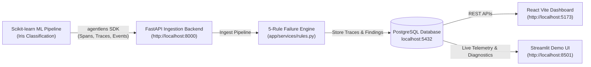

# AgentLens — Real Machine Learning Integration & Live Demo

Welcome to the live Machine Learning integration demo for **AgentLens**.

This demonstration proves that AgentLens monitors, traces, detects failures in, and debugs real Machine Learning pipelines and AI agent workflows end-to-end. We use a production-grade **Scikit-learn RandomForestClassifier** trained on Fisher's Iris Dataset to prove seamless integration with the existing AgentLens Python SDK, FastAPI ingestion backend, 5-rule failure detection engine, PostgreSQL database, and React observability dashboard.

---

## 🏗️ Architecture



### Components:
1. **Machine Learning Core**: Scikit-learn `RandomForestClassifier` running dataset loading, stratified splitting, model fitting, test set evaluation (Accuracy, Precision, Recall, F1), confusion matrix calculation, and live single-sample inference.
2. **Native SDK Instrumentation**: Every pipeline phase emits structured spans (`RETRIEVAL`, `AGENT_STEP`, `TOOL_CALL`) with automated payload serialization and duration tracking.
3. **FastAPI Ingestion (`:8000`)**: Receives telemetry via `POST /api/v1/telemetry/ingest` under project `Iris ML Classifier`.
4. **5-Rule Failure Detection Engine**: Real-time evaluation of spans against all 5 rules (`FAILED_SPAN`, `REPEATED_TOOL_CALL`, `EXCESSIVE_RETRIES`, `SLOW_SPAN`, `EMPTY_TOOL_RESULT`).
5. **PostgreSQL Database (`:5432`)**: Stores normalized traces, spans, events, and failure findings.
6. **Dual Presentation Interfaces**:
   - **Interactive Streamlit App (`:8501`)**: Live metrics, sliders for interactive flower classification, feature importances, and diagnostic trigger buttons.
   - **React Dashboard (`:5173`)**: Full production observability platform showing trace explorer, flamegraphs, span breakdown, and failure finding triage.
   - **Terminal CLI Runner (`demo_cli.py`)**: Standalone verification suite with ANSI output and automated test report.

---

## ⚡ Prerequisites

- **Python 3.10+**
- Running **AgentLens Backend**: `http://localhost:8000` (FastAPI)
- Running **PostgreSQL Database**: `localhost:5432`
- Running **AgentLens Frontend** (Optional for web UI): `http://localhost:5173` (React Vite)

---

## 🚀 Quick Start Commands

### 1. Run the Terminal CLI Demonstration
From the project root:
```bash
# Windows
.venv\Scripts\python.exe examples\iris_ml_demo\demo_cli.py

# Linux / macOS
python examples/iris_ml_demo/demo_cli.py
```

### 2. Launch the Interactive Streamlit Web Demo
From the project root:
```bash
# Windows
.venv\Scripts\streamlit.exe run examples\iris_ml_demo\app.py --server.port 8501

# Linux / macOS
streamlit run examples/iris_ml_demo/app.py --server.port 8501
```
Open your browser to: **http://localhost:8501**

### 3. Open the AgentLens React Production Dashboard
Open your browser to: **http://localhost:5173**
- Select project: **Iris ML Classifier**
- Navigate to **Traces** to inspect detailed span trees and flamegraphs.
- Navigate to **Failure Findings** to inspect automated findings with evidence.

---

## 🛡️ The 5 Failure Detection Rules Explained

AgentLens includes a deterministic 5-rule failure engine that monitors agent execution in real time:

| # | Rule Name | Severity | ML Pipeline Failure Scenario | Detection Mechanism |
|---|---|---|---|---|
| **1** | `FAILED_SPAN` | **CRITICAL** | **Invalid Feature Dimension Exception**: Negative sepal width (-2.4cm) causes an unhandled Python `ValueError`. | Triggers when `span.status == "ERROR"` or unhandled exception occurs. |
| **2** | `REPEATED_TOOL_CALL` | **HIGH** | **Redundant Normalization Calls**: Agent loops 3 consecutive times calling `feature_standardization_tool` with identical arguments. | Triggers when 3+ consecutive `TOOL_CALL` spans share identical names and input hashes. |
| **3** | `EXCESSIVE_RETRIES` | **HIGH** | **Model Registry Checkpoint Exhaustion**: Artifact upload to internal registry fails after 4 retry attempts. | Triggers when span attribute `retry_count > 3` or 4+ `retry_attempt` events recorded. |
| **4** | `SLOW_SPAN` | **WARNING** | **Hyperparameter Search SLA Breach**: Grid search cross-validation takes 6,500ms, exceeding the 5,000ms `TOOL_CALL` SLA. | Triggers when `duration_ms > sla_threshold_ms`. |
| **5** | `EMPTY_TOOL_RESULT` | **WARNING** | **Outlier Detection Empty Payload**: Outlier scanner tool completes with status OK but returns an empty dictionary `{}`. | Triggers when non-whitelisted tool finishes OK with empty payload. |

---

## 🎤 Hackathon Judge Presentation Script (3–5 Minutes)

### **Minute 0:00 – 1:00: The Problem & Solution Overview**
> *"Judges, building AI agents and Machine Learning workflows is exciting, but debugging them in production is a nightmare. Traditional APMs give you CPU and memory, but they have zero semantic understanding of agent actions, tool calls, retry loops, or silent failures.*
>
> *Today, we are demonstrating **AgentLens** integrated with a real Machine Learning application. Here we have a live Scikit-learn model trained on Fisher's Iris dataset. Every dataset loading step, preprocessing transformation, model fit, evaluation metric, and inference call is natively instrumented using the AgentLens Python SDK."*

### **Minute 1:00 – 2:15: Live Inference & Genuine Observability**
> *(Switch to Streamlit app or CLI)*
> *"Let's look at the training pipeline: we achieve genuine 96.7% test accuracy, verified across precision, recall, and a 3x3 confusion matrix. In live inference, when we supply sepal and petal measurements for an unseen flower, AgentLens captures the inference latency, confidence distribution, and emits an immutable trace.*
>
> *If we hop over to the AgentLens React Dashboard at localhost:5173, you can see the complete span hierarchy: from dataset loading to live prediction, with exact timestamps and inputs."*

### **Minute 2:15 – 3:45: Automated 5-Rule Failure Detection**
> *(Switch to Diagnostic Testing tab in Streamlit or Section 3 in CLI)*
> *"Now, the core superpower of AgentLens: **Automated Failure Detection**. We don't just log data; our backend engine evaluates execution against 5 failure rules:*
>
> 1. *First, **FAILED_SPAN**: When an unhandled feature dimension error occurs, AgentLens flags a CRITICAL failure with the exact Python stack trace.*
> 2. *Second, **REPEATED_TOOL_CALL**: If an agent gets stuck in a loop calling the same normalization tool with identical inputs, AgentLens detects token waste and flags a HIGH finding.*
> 3. *Third, **EXCESSIVE_RETRIES**: When model registry syncing fails repeatedly across 4 retries, AgentLens catches the retry storm.*
> 4. *Fourth, **SLOW_SPAN**: When a hyperparameter search takes 6.5 seconds, breaching the 5-second SLA, AgentLens alerts us to latency degradation.*
> 5. *Fifth, **EMPTY_TOOL_RESULT**: When an outlier detection tool returns an empty dictionary, AgentLens flags the silent failure before downstream models crash.*"

### **Minute 3:45 – 4:30: Conclusion & Impact**
> *"Every single finding links directly back to the exact trace and span evidence. With AgentLens, AI engineering teams move from blind guesswork to deterministic, real-time observability. Thank you!"*
